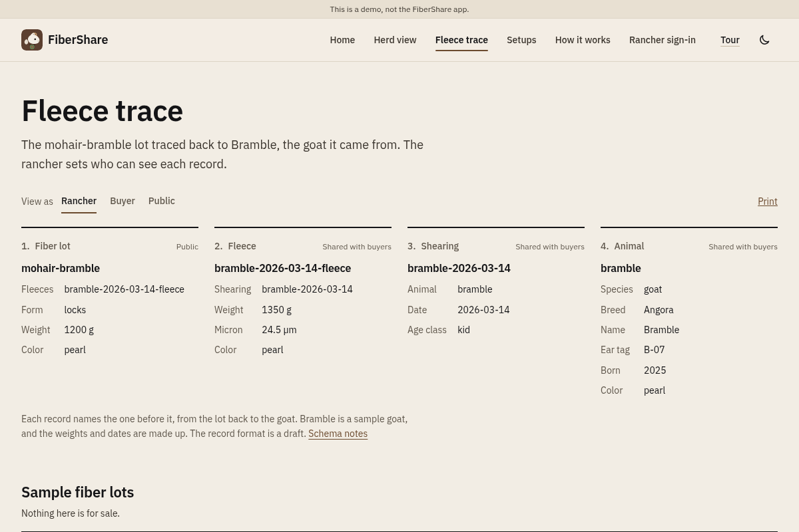

# FiberShare (open source)

**FiberShare OSS** is a browser demo of ranch herd tracking and fiber traceability: a sample goat herd on a paddock grid, day Play with alerts, paddock moves, and a short tracker trail, plus a fleece lot you can trace back to the animal. It runs on sample data, works offline, and is meant for ranchers, hardware makers, and developers who want to see the idea before wiring real collars.

This repository is **not** the FiberShare app at [fibershare.app](https://fibershare.app). Ranch support pays for animals and pasture. Support is not ownership or an investment return. BitPrairie LLC builds FiberShare.


## Features (what is shipped)

- **Herd view.** Eight sample goats on a virtual paddock grid (a drawing, not GPS). Stats for trackers reporting, open alerts, and last check-in. Day **Play** scrubs one made-up day.
- **Alerts.** Low battery, quiet tracker, not-moving, out-of-paddock, SOS, plus simulated Predator Watch and Wildfire Watch on the sample day. Confirm, dismiss, or reopen; answers stay in the browser on sample data.
- **Paddock moves.** A short log of sample paddock moves and grazing notes that advances with Play.
- **Tracker trail.** Select a goat during Play to see a short trail of its last few positioned check-ins.
- **Fleece trace.** Trace the `mohair-bramble` lot through fleece and shearing records to Bramble. Viewer modes for rancher, buyer, and public. Nothing is for sale.
- **Setups.** Your own hardware, hosted by BitPrairie, or a mix.
- **Rancher sign-in and map.** Public view hides tracker details; a signed-in rancher can see real names and positions. See [docs/rancher-access.md](docs/rancher-access.md).
- **Tour.** Five short steps on the sample data (keyboard: arrows, Esc).

| Herd view | Fleece trace |
| --- | --- |
|  |  |

## Docs and schemas

| Link | What it is |
| --- | --- |
| [docs/DIRECTION.md](docs/DIRECTION.md) | Demo vs the FiberShare app |
| [docs/rancher-access.md](docs/rancher-access.md) | Local passphrase and Cloudflare Access |
| [docs/chirpstack.md](docs/chirpstack.md) | Pull live trackers from ChirpStack v4 |
| [docs/schemas/](docs/schemas/README.md) | Draft animal, shearing, fleece, and fiber-lot JSON Schemas |
| [docs/schemas/examples/](docs/schemas/examples/) | Example records used by the fleece trace |
| [ROADMAP.md](ROADMAP.md) | Shipped vs planned work |
| [CONTRIBUTING.md](CONTRIBUTING.md) | How to help |

## Automated jobs

| Job | Rule |
| --- | --- |
| Flags tracker batteries below 20% | Trackers on outside power are skipped |
| Flags trackers that stop reporting | No check-in for over 2 hours |
| Flags trackers not moving near the same spot | Still checking in for over 2 hours with little movement |
| Flags a position outside the paddock | Active paddock bounds are 0-100 on the grid |
| Raises an alert when a tracker sends an SOS | The alert names the animal |
| Lists Predator Watch reports near the herd | The sample day has one simulated report |
| Lists Wildfire Watch smoke reports upwind | The rancher map adds public fire, smoke and air quality layers |
| Traces a fiber lot back to the goat | Through the fleece and shearing records |
| Checks for a new live file every 2 minutes | Live data only. The pull script runs only when you start it |

Every job is on until you turn it off, on How it works or in the herd view's Alert settings. The setting is saved in the browser. Each automated alert says which rule and reading raised it and when the rules ran, for example "Battery 14%, below the 20% limit, not on outside power." With every job off, a rancher can still answer and add alerts, save notes, mark animals checked and change the battery, quiet, and not-moving limits.

Alerts are an aid, not a guarantee. They can be late, wrong or missing, and turning a job off stops its alerts. Keep checking your animals in person. In an emergency, call 911.

The default thresholds are in `src/alert-config.js`. The rules are in `src/alerts.js`, and the browser and the server run the same code. Each answer is stored with the rule that raised the alert.

The rancher makes every decision. Nothing moves animals, opens gates or contacts anyone without the rancher's OK.

The planned work covers fuller grazing records for each paddock, learning each tracker's normal check-in pattern, tuning the alert rules from rancher answers, and sharing a confirmed predator report with nearby ranchers. [ROADMAP.md](ROADMAP.md) has the detail.

## Setups

| Setup | What it means |
| --- | --- |
| Your own hardware | You build or buy the trackers and gateway and run the server yourself. Nothing has to leave the ranch. |
| Hosted by BitPrairie | BitPrairie runs the server and can supply the trackers. |
| A mix | Your gateway and server on the ranch, with hosted alerts from BitPrairie. |

The community network is the main part of the project. Ranchers share through a self-hosted or co-op server. The code is MIT licensed, so anyone may use it. Joining the community network through a self-hosted or co-op server is free for non-commercial and research use. BitPrairie's hosted service and hardware kits are priced to cover hardware and hosting. The hosted alerts come from Predator Watch and Wildfire Watch, which run on BitPrairie's intelligence and realtime systems.

| Open source (free) | BitPrairie (commercial) |
| --- | --- |
| This demo | The hosted FiberShare app |
| Record schemas (draft) | BitPrairie's trained models and datasets |
| Self-hosting docs | Hosted alerts and relay |
| | Hardware kits and support |

Open models that BitPrairie builds on keep their own licenses.

## Your data

- Public pages never show where an animal is.
- Tracker positions stay on the server until the rancher signs in.
- In the FiberShare app, positions become cells on a private grid when they arrive. GPS coordinates are not stored.
- Each rancher owns their event history. It is shared only if they opt in.
- Planned: data shared with agencies or researchers is combined or delayed, with no exact locations.

This repository holds no secrets, API keys, mail settings or real collar data. A test checks every committed file for DevEUI-like hex strings and coordinates.

## Quick start

You need Node 20.9 or newer. `npm run pages:dev` needs Node 22 or newer.

```bash
git clone https://github.com/steelhead99x/fibershare-oss.git
cd fibershare-oss
npm install
npm run dev
```

Then open http://localhost:5173.

| Command | What it does |
| --- | --- |
| `npm run dev` | Serves the site with Vite at http://localhost:5173 |
| `npm run build` | Builds the site into `dist/` |
| `npm run preview` | Serves the built site |
| `npm run pages:dev` | Serves `dist/` with Wrangler 4, including `/api/health` |
| `npm run lint` | Checks the JavaScript files for syntax errors |
| `npm test` | Runs the tests for data, schemas, alerts, sign-in, map layers, the live-data pull and the page copy |
| `npm run chirpstack:pull` | Reads your trackers from your network server into `.local/live.json`. See [docs/chirpstack.md](docs/chirpstack.md) |
| `npm run rancher:passphrase` | Sets the rancher passphrase for local sign-in. See [docs/rancher-access.md](docs/rancher-access.md) |
| `npm run serve:local` | Serves `dist/` and the API at http://127.0.0.1:4174 |
| `npm run layers:check` | Checks that every map layer still answers |

The sample goats, events and fiber lots are in `public/data/herd.json`, `public/data/events.json` and `public/data/shop.json`.

## Live data from your own network server

The pull script supports ChirpStack v4. If your LoRaWAN collar trackers report to it, `npm run chirpstack:pull` reads your devices and writes `.local/live.json`. Git ignores that file and the build leaves it out. `npm run dev` then shows your trackers, how long ago they were pulled, and a **Hide tracker details** setting. Add `--watch=120` to keep pulling.

The page reads the data from `/api/live`, never from the file. The public gets the hidden view: aliases such as Tracker 3, no device IDs, tags or positions, and grid cells from a hash. A signed-in rancher gets real values if the pull ran with `FIBERSHARE_HIDE_TRACKERS=0`. Sign-in is a passphrase on your own hardware, or Cloudflare Access on Pages, where `--push` sends the data to a KV namespace.

Setup is in [docs/chirpstack.md](docs/chirpstack.md) and [docs/rancher-access.md](docs/rancher-access.md).

## How it is built

```
Browser
  └── Cloudflare Pages (project name fibershare-dev)
        ├── Pages (home, herd view, fleece trace, setups, how it works, rancher sign-in)
        ├── /data/*.json  (sample goats, events and fiber lots)
        └── Pages Functions
              ├── /api/health  (the site is up)
              ├── /api/live    (hidden data, or full data for a signed-in rancher, from KV)
              ├── /api/alerts  (a signed-in rancher's answers, in KV)
              ├── /api/session and /api/rancher/login  (Cloudflare Access sign-in)
              └── /api/push    (your pull sends data here with a token)
```

`fibershare-dev` is the project name for a copy of this demo, not the FiberShare app.

On your own hardware, `npm run dev`, `npm run preview` and `npm run serve:local` answer `/api/live`, `/api/session` and `/api/alerts` from `.local/`. The access rules are in `server/`. The rancher map uses [Leaflet](https://leafletjs.com/) and [Esri Leaflet](https://developers.arcgis.com/esri-leaflet/), loaded only for a signed-in rancher. Their licenses are in `public/licenses/map-libraries.txt`.

## Related sites

None of these sites is this repository.

- [fibershare.app](https://fibershare.app) is the FiberShare app. It needs sign-in.
- [bitprairie.com/fibershare](https://bitprairie.com/fibershare/) is the project page. [fibershare.dev](https://fibershare.dev) leads there.
- [fibershare.us](https://fibershare.us) leads to the FiberShare app.

Please do not open issues here about the FiberShare app, orders or private herd data. [docs/DIRECTION.md](docs/DIRECTION.md) explains the split between the demo and the app.

## Contributing

Ranchers, hardware makers and developers are welcome. See [CONTRIBUTING.md](CONTRIBUTING.md) and the [Code of Conduct](CODE_OF_CONDUCT.md). Chat is on [Discord](https://discord.gg/m3x8R3sF6N).

## License

[MIT](LICENSE). Copyright 2026 BitPrairie LLC.
