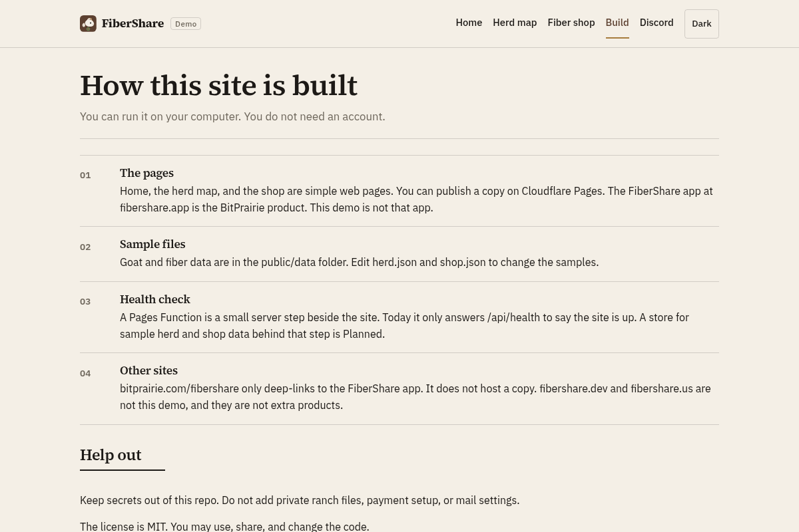

# FiberShare (open source)

FiberShare is a ranch program from BitPrairie LLC. It is for people who follow goats, work with fiber, or want a ranch to last. Support pays for animals and pasture. It is not ownership or an investment return.

This repository is a demo of that idea. It is for people who want to read the code, run a sample copy, or help improve the demo. You get a sample herd map and a sample fiber list. This repository is not the FiberShare app.

## What this demo does

- Shows sample goats on a pasture drawing. The pins are positions on the drawing. This is not a real ranch herd.
- Lists sample fiber. You cannot check out.
- Explains ranch support. Support pays for animals and pasture. It is not ownership or an investment return.
- Runs on your computer with Node 20.

There are no secrets in this repo. No API keys. No mail settings. No real collar data.

## The FiberShare app

BitPrairie LLC has one FiberShare app, at [fibershare.app](https://fibershare.app).

[bitprairie.com/fibershare](https://www.bitprairie.com/fibershare) only deep-links to that app. It does not host a copy.

[fibershare.dev](https://fibershare.dev) and [fibershare.us](https://fibershare.us) are not this repository, and they are not extra products. [fibershare.us](https://fibershare.us) leads to the FiberShare app.

Do not open issues here about the FiberShare app, orders, or private herd data.

More of this split is in [docs/DIRECTION.md](docs/DIRECTION.md).

## Quick start

You need Node 20.

```bash
git clone https://github.com/steelhead99x/fibershare-oss.git
cd fibershare-oss
npm install
npm run dev
```

Then open http://localhost:5173.

| Command | What it does |
| --- | --- |
| `npm run dev` | Serves the local site at http://localhost:5173 |
| `npm run build` | Builds the site into `dist/` |
| `npm run preview` | Serves the built site |
| `npm run pages:dev` | Serves `dist/` with Wrangler 3 on Node 20, including `/api/health` |

`npm run dev` serves the pages and the sample JSON. The `/api/health` function is included when you use `npm run pages:dev` after `npm run build`.

Sample goats and fiber are in `public/data/herd.json` and `public/data/shop.json`.

## Screenshots

These pictures are from a local `npm run dev` run on 26 Oct 2026. They show this demo, not the FiberShare app.

### Home


### Herd map


### Fiber list


### How it is built



## How it is built

```
Browser
  └── Cloudflare Pages (project name fibershare-dev)
        ├── Pages (home, map, shop)
        ├── /data/*.json  (sample goats and fiber)
        └── Pages Functions
              └── /api/health  (says the site is up)
```

The project name `fibershare-dev` is a label for a copy of this demo. It is not the FiberShare app.

You can run the built files in `dist/` on your own server. You do not need an account to try the demo.

A later store for this demo's sample data, behind Pages Functions, is Planned. This demo stays as files so you can run it alone. See [ROADMAP.md](ROADMAP.md).

## Help out

You need a GitHub account to send a change. Chat is on Discord. You need a Discord account.

Join the chat: [Discord](https://discord.gg/m3x8R3sF6N).

See [CONTRIBUTING.md](CONTRIBUTING.md) and the [Code of Conduct](CODE_OF_CONDUCT.md). Small pull requests are welcome. A pull request is the change you ask us to add.

Start with the herd map, fiber fields, easier pages, or the docs.

## License

[MIT](LICENSE) © 2026 BitPrairie LLC, a California LLC · legal@bitprairie.com

You may use, share, and change the code.
