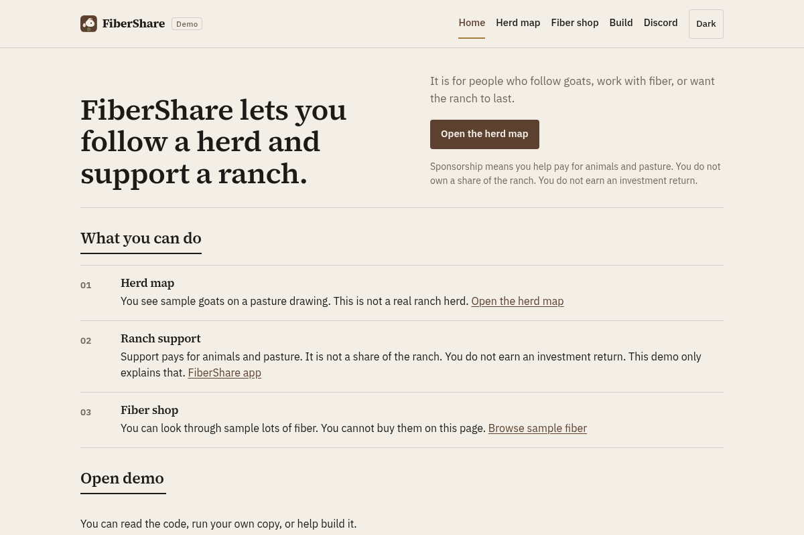
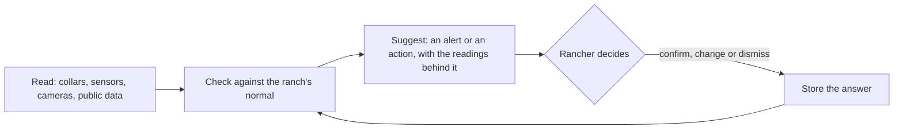
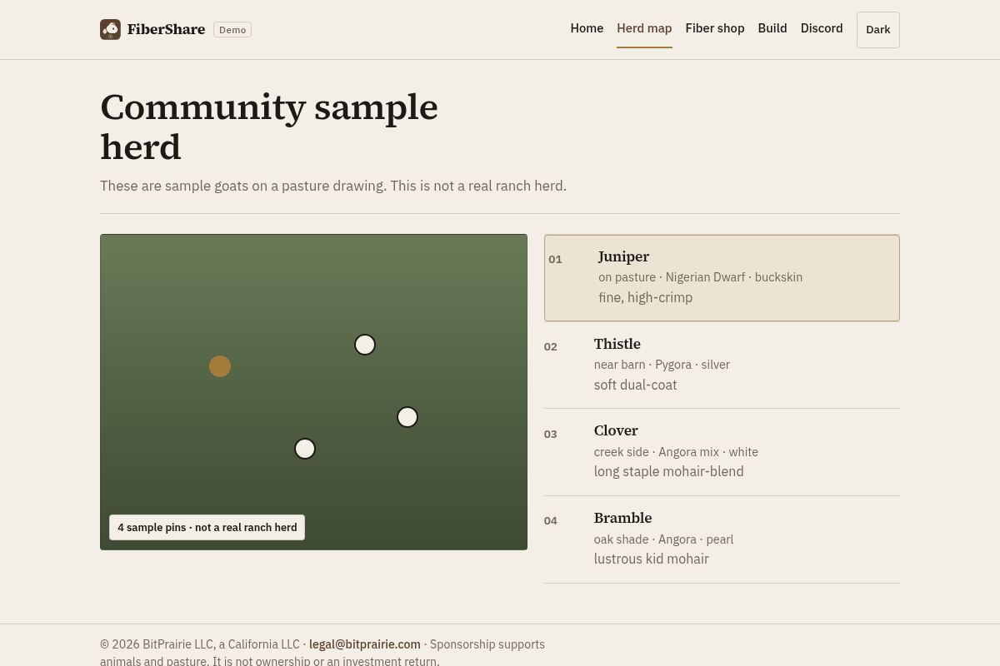
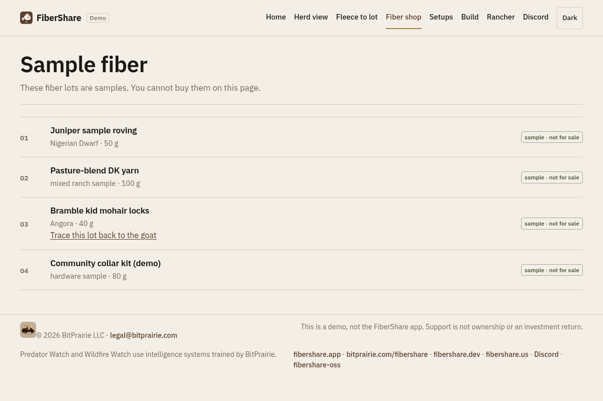

# FiberShare (open source)

FiberShare is a ranch program from BitPrairie LLC, running since about 2020. It started with goats and fiber and is growing into a network of local ranchers across the western US, with collar trackers, paddock cameras, and predator and wildfire detection on the ranch.

Support for a ranch pays for animals and pasture. It is not ownership or an investment return.

This repository is a demo for people who want to read the code, run a sample copy, or help improve it. It is not the FiberShare app at [fibershare.app](https://fibershare.app).



## What the loops do

FiberShare's intelligence and realtime systems read tracker, sensor and camera data around the clock and turn it into alerts and suggestions. Each loop does one job. The rancher decides every time: nothing moves animals, opens gates or contacts anyone without the rancher's OK. Each answer the rancher gives is stored, so the next suggestion fits that ranch better.



| Job | What it reads | What it suggests | How it improves | Status |
| --- | --- | --- | --- | --- |
| **Find an animal in trouble** | Collar movement and SOS button presses | An alert naming the animal, with the readings that set it off | Confirmed and dismissed alerts set when the next one fires, so there are fewer false alarms | In use in the FiberShare app: alerts, and the rancher's confirm or dismiss. In this demo: SOS, predator and smoke alerts with confirm or dismiss, on simulated sample alerts. Built and tested: the movement and distress feed to Predator Watch. Planned: learning from the rancher's answers |
| **Catch a dying or silent tracker** | Battery level, last check-in, signal at the gateway | Charge or swap a tracker, check a collar that went quiet, check a gateway that is missing readings | Learns each device's normal check-in pattern | In use in the FiberShare app: low-battery and quiet-tracker alerts. In this demo: the same alerts from the sample herd or your own ChirpStack trackers, with confirm or dismiss, and each answer kept as a feedback record. Planned: learning each device's pattern, and tuning the rules from the answers |
| **Plan the next paddock move** | Time each group spends in each paddock, forage notes, weather | When to move a group and where to | Compares each suggestion with what the rancher did and how the paddock recovered | Planned |
| **Plan a move ahead of fire or smoke** | Ranch temperature, humidity and air readings, plus public fire, smoke and fire-weather layers | A move plan: which animals first, to where, through which gate | The rancher marks what worked after each event | Sensor feed to Wildfire Watch: being built. Move plans: Planned |
| **Warn neighbors about predator activity** | Confirmed predator events from ranches that opt in | A heads-up to nearby ranchers when confirmed events cluster | More confirmed events make the pattern clearer | Planned. Shared events will be delayed and placed on a coarse grid, with no ranch names or real locations |
| **Link fiber quality to breeding and grazing** | Fleece weight, micron and color, with each animal's paddock and health history | Which animals and grazing seasons go with the best fiber lots | Each shearing adds a season of results | Records: in use. Suggestions: Planned |

The demo's "day of events" shows what herd, device and wildfire alerts look like, using simulated data.

## Two networks, three setups

| Network | What it is |
| --- | --- |
| Community | Non-commercial. Ranchers share through a self-hosted or co-op setup. This is the main part of the project, and research use is welcome. |
| Commercial | BitPrairie's hosted services and ready-made gear. It is kept small and mainly covers the cost of hardware and hosting. |

You can also run this code on your own ranch and share with no one.

| Setup | What it means |
| --- | --- |
| Your own hardware | You build or buy the gear and run it yourself. |
| Hosted by BitPrairie | BitPrairie runs the hosting for you. |
| A mix | Your gear on the ranch, with BitPrairie hosting the parts you choose. |

Field gear: 3D-printed ASA cases, small solar panels and LoRa radios.

## What is open

| Open source (free) | BitPrairie (commercial) |
| --- | --- |
| This demo | The hosted FiberShare app |
| Record schemas (draft) | BitPrairie's own trained models and datasets |
| Self-hosting docs | Hosted alerting and relay |
| | Hardware kits and support |

Open models that BitPrairie builds on keep their own licenses.

## The wider project

- **FiberShare app** at [fibershare.app](https://fibershare.app): ranch support, a live collar map and a fiber shop. It needs sign-in.
- **Predator Watch** at [bitprairie.com/predator-watch](https://bitprairie.com/predator-watch/): earlier warning about predators near livestock, so the rancher hears sooner and decides what to do.
- **Wildfire Watch** at [bitprairie.com/wildfire-watch](https://bitprairie.com/wildfire-watch/): early wildfire and smoke warning.
- **moqFeeder**: paddock video over Media over QUIC.

All of these share the same sensors, LoRa radios and solar power on the ranch.

| Feed | Status |
| --- | --- |
| Collar movement and distress events to Predator Watch | Built and tested |
| Ranch sensor readings to Wildfire Watch | Being built |
| Wildfire relay to local alerting systems, with the rancher's consent | Planned |
| Photo upload page for people on the [mailing list](https://bitprairie.com/predator-watch/#subscribe) | Planned |

## Your data

- Public pages never show where an animal is.
- In this demo, tracker positions are hidden on the server unless the rancher signs in. Only the signed-in rancher sees their own trackers on a real map.
- In the FiberShare app, positions are turned into a private virtual grid when they arrive, and the GPS coordinates are not stored.
- Training data stays on BitPrairie's hardware and is used only to train and test.
- Each rancher's event history belongs to that rancher and is shared only if they opt in.
- Planned: anything shared with agencies or researchers will be aggregated or delayed, with no exact locations.

## What this demo does

- **Herd view.** Eight sample goats on a virtual paddock grid, 6 by 4 cells. The grid is a drawing, not GPS. Pick a goat to see its breed, fiber, tracker battery, last check-in, and check-ins per hour.
- **A day of events.** A made-up day of tracker check-ins, a low battery, a quiet tracker, a wildfire smoke alert and a predator alert, each marked simulated. Press Play the day to step through it.
- **Alerts to answer.** Low-battery alerts (below 20% and not on outside power) and quiet-tracker alerts (nothing heard for over 2 hours) come from the tracker data. The sample Predator Watch and Wildfire Watch alerts are listed with them. Confirm or dismiss each one, with an optional note, and reopen it from the history list. The thresholds are in `src/alert-config.js`. On sample data and the public live view, answers stay in your browser. A signed-in rancher's answers go to `/api/alerts`, behind the same sign-in check as the real data: `.local/alert-feedback.json` on your own hardware, or the KV namespace on Pages. Each answer is kept as a feedback record with the rule that raised it. Planned: tuning the rules from those records.
- **Six jobs, with their status.** The home page lists the six jobs above and marks each one In the demo, Partly built or Planned.
- **Fleece to fiber lot.** Follow the sample goat Bramble from her shearing to her fleece to the `mohair-bramble` lot, using the draft records in `docs/schemas/examples/`. Switch between rancher, buyer and public to see what each record shares.
- **Three setups**, side by side.
- **Your own trackers.** Read your trackers from your own ChirpStack v4 server. See [docs/chirpstack.md](docs/chirpstack.md).
- **Rancher sign-in and a real map.** The public always gets hidden tracker data. A signed-in rancher gets real names and positions on a map with public map layers: imagery, topo and street basemaps, wildfire perimeters and incidents, weather warnings, fire weather, smoke, air quality, federal land ownership, and any ArcGIS or GeoJSON layer you add. See [docs/rancher-access.md](docs/rancher-access.md).
- **A guided tour for live demos.** Press Tour in the header. Nine short steps: what FiberShare is, the herd, a smoke alert, a predator alert, the alerts to answer, one goat up close, the fleece trace, the rancher map and the setups. The tour always uses the sample data, so it works offline. Arrow keys move between steps and Esc ends it. The last step has Reset demo, which clears the demo's saved settings except the theme.
- **Sample fiber list** with no checkout, and a page that explains ranch support. Checkout and ranch support are Planned.
- Runs on Node 20 or 22 and works offline from the bundled sample data.

This repo has no secrets: no API keys, no mail settings and no real collar data. A test checks every committed file for DevEUI-like hex strings and coordinates.

| Herd view | Sample fiber list |
| --- | --- |
|  |  |

## Quick start

You need Node 20 or newer. `npm run pages:dev` needs Node 22 or newer.

```bash
git clone https://github.com/steelhead99x/fibershare-oss.git
cd fibershare-oss
npm install
npm run dev
```

Then open http://localhost:5173.

| Command | What it does |
| --- | --- |
| `npm run dev` | Serves the local site with Vite at http://localhost:5173 |
| `npm run build` | Builds the site into `dist/` |
| `npm run preview` | Serves the built site |
| `npm run pages:dev` | Serves `dist/` with Wrangler 4 (Node 22 or newer), including `/api/health` |
| `npm run lint` | Checks the JavaScript files for syntax errors |
| `npm test` | Tests the sample data, record schemas, herd view, ChirpStack pull, rancher sign-in, map layers, the alerts and their answers, and the server routes |
| `npm run chirpstack:pull` | Reads your trackers from your ChirpStack server into `.local/live.json`. See [docs/chirpstack.md](docs/chirpstack.md) |
| `npm run rancher:passphrase` | Sets the rancher sign-in passphrase for local mode. See [docs/rancher-access.md](docs/rancher-access.md) |
| `npm run serve:local` | Serves `dist/` and the API on your own hardware at http://127.0.0.1:4174 |
| `npm run layers:check` | Checks that every map layer still answers |

Sample goats, events and fiber are in `public/data/herd.json`, `public/data/events.json` and `public/data/shop.json`.

## Live data from your own ChirpStack

If you run ChirpStack v4 for LoRaWAN collar trackers, `npm run chirpstack:pull` reads your devices on your own hardware and writes `.local/live.json`, which git ignores. `npm run dev` then shows a **Live from your ChirpStack** badge, how long ago the data was pulled, and a **Hide tracker details** setting. Use `--watch=120` to keep pulling.

The page gets the data from `/api/live`, never from the file. Everyone gets the hidden view: aliases such as Tracker 3, no device IDs, tags or positions, and grid cells from a hash. Only a signed-in rancher gets real values, and only if the pull ran with `FIBERSHARE_HIDE_TRACKERS=0`. Sign-in is a passphrase on your own hardware, or Cloudflare Access on Pages, where `--push` sends the data to a KV namespace. The live file is never part of `npm run build`.

Setup: [docs/chirpstack.md](docs/chirpstack.md) for the pull, including a podman command for the compose network, and [docs/rancher-access.md](docs/rancher-access.md) for sign-in, the map layers and their terms.

## How it is built

```
Browser
  └── Cloudflare Pages (project name fibershare-dev)
        ├── Pages (home, herd view, fleece to lot, shop, setups)
        ├── /data/*.json  (sample goats, events, and fiber)
        └── Pages Functions
              ├── /api/health  (says the site is up)
              ├── /api/live    (hidden data, or full data for a signed-in rancher, from KV)
              ├── /api/alerts  (a signed-in rancher's answers to alerts, in KV)
              ├── /api/session and /api/rancher/login  (Cloudflare Access sign-in)
              └── /api/push    (your pull sends data here with a token)
```

`fibershare-dev` is the project name for a copy of this demo, not the FiberShare app.

On your own hardware, `npm run dev`, `npm run preview` and `npm run serve:local` answer the same `/api/live`, `/api/session` and `/api/alerts` from `.local/`. The rule for who gets what is in `server/`. The rancher map uses [Leaflet](https://leafletjs.com/) and [Esri Leaflet](https://developers.arcgis.com/esri-leaflet/), loaded only for a signed-in rancher. Their licenses are in `public/licenses/map-libraries.txt`.

You can run the built files in `dist/` on your own server. You do not need an account to try the demo.

## Where things live

None of these sites is this repository:

- [bitprairie.com/fibershare](https://bitprairie.com/fibershare/) is the FiberShare project page.
- [fibershare.dev](https://fibershare.dev) leads to that page.
- [fibershare.us](https://fibershare.us) leads to the FiberShare app.
- The FiberShare app at [fibershare.app](https://fibershare.app) needs sign-in.

Please do not open issues here about the FiberShare app, orders or private herd data.

More on this split is in [docs/DIRECTION.md](docs/DIRECTION.md). What comes next is in [ROADMAP.md](ROADMAP.md).

## Help out

Ranchers, hardware makers and developers are welcome. See [CONTRIBUTING.md](CONTRIBUTING.md) and the [Code of Conduct](CODE_OF_CONDUCT.md). Chat is on [Discord](https://discord.gg/m3x8R3sF6N).

## License

[MIT](LICENSE). Copyright 2026 BitPrairie LLC.
